# Underwater 3D Reconstruction from Expedition Video

**Summer Internship Project · CSIR–National Institute of Oceanography, Goa · May–July 2022**

An exploration of photogrammetry for documenting underwater archaeological artifacts at Dwarka, India. I turned selected expedition footage into textured 3D models and compared reconstruction workflows.

## From underwater imagery to a model

Each row pairs four widely spaced input views with the reconstructed artifact. Click a collage to enlarge it, or an animated preview to open the full-resolution video.

<table>
  <tr><th width="50%">Input frames</th><th width="50%">Reconstruction video</th></tr>
  <tr>
    <td width="50%" align="center"><a href="assets/images/artifact-1-source-collage.jpg">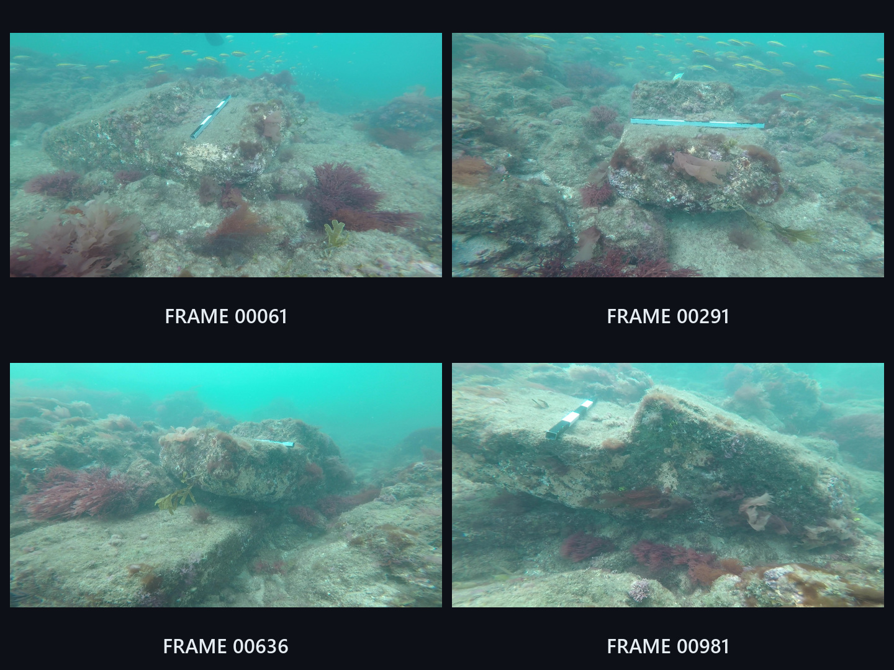</a> <strong>Artifact 1</strong> · Selected input views</td>
    <td width="50%" align="center"><a href="assets/videos/artifact-1.mp4">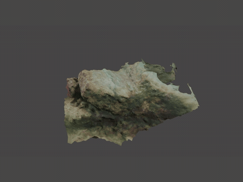</a> <strong>Artifact 1</strong> · <a href="assets/videos/artifact-1.mp4">Full video</a></td>
  </tr>
  <tr>
    <td width="50%" align="center"><a href="assets/images/artifact-3-source-collage.jpg">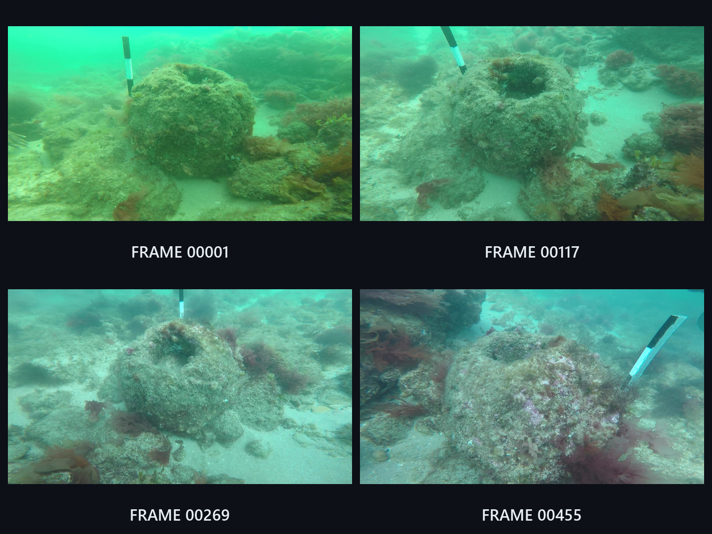</a> <strong>Artifact 3</strong> · Selected input views</td>
    <td width="50%" align="center"><a href="assets/videos/artifact-3.mp4">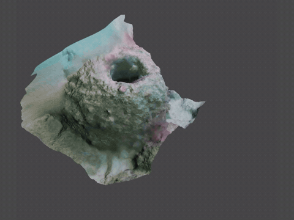</a> <strong>Artifact 3</strong> · <a href="assets/videos/artifact-3.mp4">Full video</a></td>
  </tr>
  <tr>
    <td width="50%" align="center"><a href="assets/images/artifact-5-source-collage.jpg">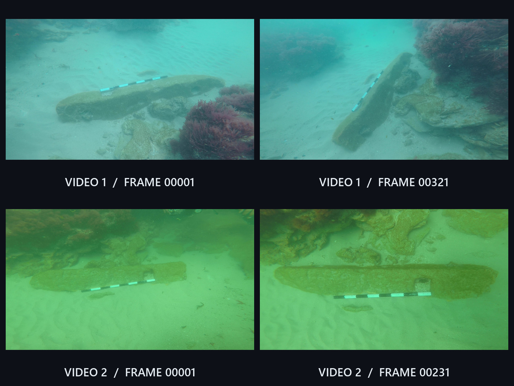</a> <strong>Artifact 5</strong> · Selected input views</td>
    <td width="50%" align="center"><a href="assets/videos/artifact-5.mp4">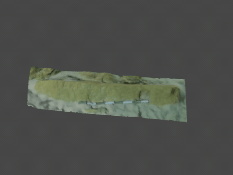</a> <strong>Artifact 5</strong> · <a href="assets/videos/artifact-5.mp4">Full video</a></td>
  </tr>
  <tr>
    <td width="50%" align="center"><a href="assets/images/artifact-6-source-collage.jpg">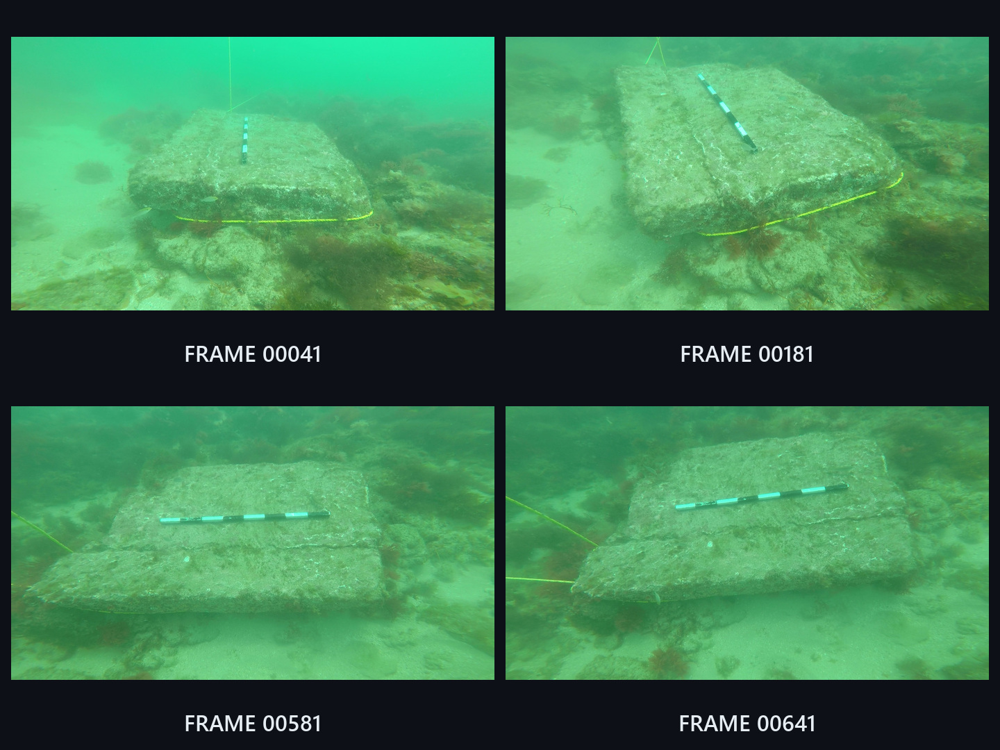</a> <strong>Artifact 6</strong> · Selected input views</td>
    <td width="50%" align="center"><a href="assets/videos/artifact-6.mp4">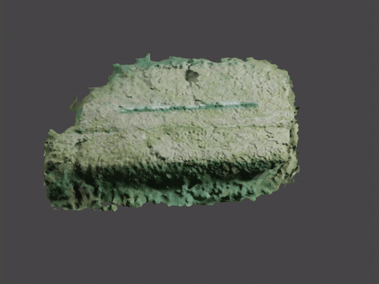</a> <strong>Artifact 6</strong> · <a href="assets/videos/artifact-6.mp4">Full video</a></td>
  </tr>
</table>

*Source frames retain their original framing and color. The videos show final presentation models from the original project. [Frame selections and media provenance](docs/media-provenance.md).*

## Comparing the reconstruction tools

<table>
  <tr><th width="50%">Meshroom · Artifact 3</th><th width="50%">Autodesk ReCap · Artifact 3</th></tr>
  <tr>
    <td>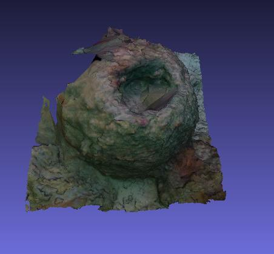</td>
    <td>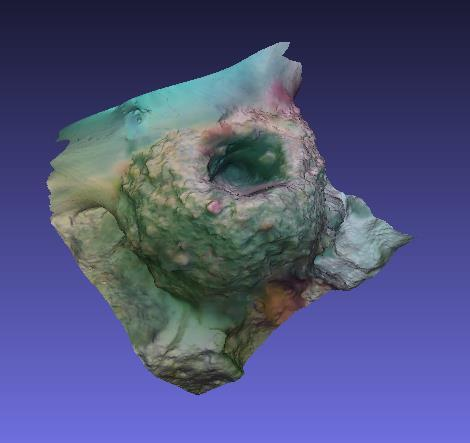</td>
  </tr>
</table>

*Original report snapshots used for qualitative comparison of surface detail, texture, and unwanted geometry.*

<strong>Focal-length metadata experiment</strong>

The 2022 report compared the same frame set with and without a nominal **3 mm** focal-length EXIF tag.

<table>
  <tr><th width="50%">With focal-length metadata</th><th width="50%">Without focal-length metadata</th></tr>
  <tr>
    <td>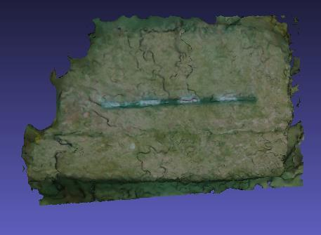</td>
    <td>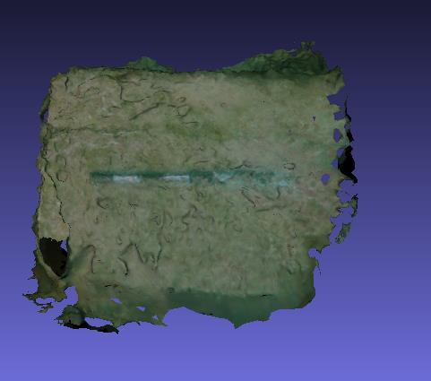</td>
  </tr>
</table>

The report describes fewer floating mesh artifacts with metadata. This was a qualitative observation. The surviving project files do not establish calibrated camera intrinsics or fully reproduce the paired experiment. See the [project notes](docs/project-notes.md) for the recovered evidence and limitations.

## Project record

- [Technical notes and recovered reconstruction statistics](docs/project-notes.md)
- [Original project report · 2022](reports/NIO_Project_report_2022.pdf)

This repository presents the 2022 results. Evaluation was qualitative; no independent geometric accuracy measurement is reported. The reconstruction algorithms were supplied by the existing tools.

**Acknowledgments:** Expedition imagery from the NIO team. Project guidance from Mr. Sundaresh and Pramod Kumar Maurya at CSIR–NIO.
