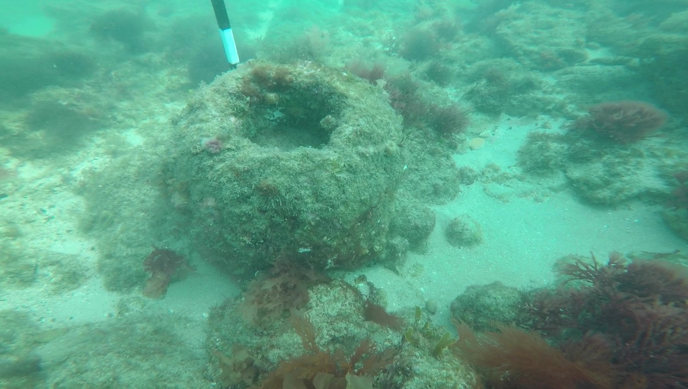
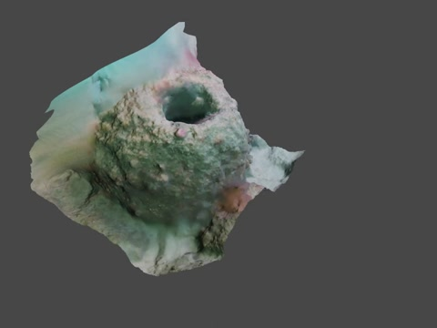

# Underwater 3D Reconstruction from Expedition Video

**Summer Internship Project · CSIR–National Institute of Oceanography, Goa · May–July 2022**

An exploration of photogrammetry for documenting underwater archaeological artifacts at Dwarka, India. I turned selected expedition footage into textured 3D models and compared reconstruction workflows.

## Reconstructed artifacts

Click a preview to open its full-resolution video.

<table>
  <tr>
    <td width="50%" align="center"> <strong>Artifact 1</strong> · <a href="assets/videos/artifact-1.mp4">Full video</a></td>
    <td width="50%" align="center"> <strong>Artifact 3</strong> · <a href="assets/videos/artifact-3.mp4">Full video</a></td>
  </tr>
  <tr>
    <td width="50%" align="center"> <strong>Artifact 5</strong> · <a href="assets/videos/artifact-5.mp4">Full video</a></td>
    <td width="50%" align="center"> <strong>Artifact 6</strong> · <a href="assets/videos/artifact-6.mp4">Full video</a></td>
  </tr>
</table>

*Final presentation models from the original project. Full-resolution MP4s are included unchanged. [Preview details and media provenance](docs/media-provenance.md).*

## From underwater imagery to a model

<table>
  <tr><th width="50%">Archived input frame · Artifact 3</th><th width="50%">Final presentation model · Artifact 3</th></tr>
  <tr>
    <td></td>
    <td></td>
  </tr>
</table>

*An archived frame from the multiview input sequence, shown alongside the final presentation model.*

The existing still photographs did not provide enough usable coverage. I screened approximately **102 GB of imagery and video**, grouped the data around six artifacts, and selected footage for **four artifacts**. The NIO team had collected the expedition data before my project began.

**My work:** footage selection, color adjustment, frame extraction and filtering, focal-length metadata experiments, reconstruction with Meshroom and Autodesk ReCap, and mesh processing and presentation with MeshLab and Blender.

**Workflow:** select footage → prepare frames → assign metadata → reconstruct → inspect and process meshes.

## Comparing the reconstruction tools

<table>
  <tr><th width="50%">Meshroom · Artifact 3</th><th width="50%">Autodesk ReCap · Artifact 3</th></tr>
  <tr>
    <td></td>
    <td></td>
  </tr>
</table>

*Original report snapshots used for qualitative comparison of surface detail, texture, and unwanted geometry.*

<strong>Focal-length metadata experiment</strong>

The 2022 report compared the same frame set with and without a nominal **3 mm** focal-length EXIF tag.

<table>
  <tr><th width="50%">With focal-length metadata</th><th width="50%">Without focal-length metadata</th></tr>
  <tr>
    <td></td>
    <td></td>
  </tr>
</table>

The report describes fewer floating mesh artifacts with metadata. This was a qualitative observation. The surviving project files do not establish calibrated camera intrinsics or fully reproduce the paired experiment. See the [project notes](docs/project-notes.md) for the recovered evidence and limitations.

## Project record

- [Technical notes and recovered reconstruction statistics](docs/project-notes.md)
- [Original project report · 2022](reports/NIO_Project_report_2022.pdf)
- [Original rendered videos on Google Drive](https://drive.google.com/drive/folders/1_581juqpWYv1QTdUgxJZUVrJMKO82Li8)

This repository presents the 2022 results. Evaluation was qualitative; no independent geometric accuracy measurement is reported. The reconstruction algorithms were supplied by the existing tools.

**Acknowledgments:** Expedition imagery from the NIO team. Project guidance from Mr. Sundaresh and Pramod Kumar Maurya at CSIR–NIO.
